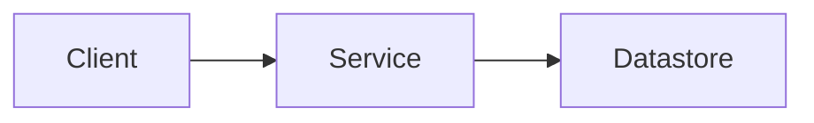

# Architecture

## Overview

Describe what the system does and who uses it.

## Components

| Component | Responsibility | Location |
|-----------|----------------|----------|
| TODO      | TODO           | `src/`   |

## Data flow

TODO: diagram or description (Mermaid is supported by GitHub).

## Key decisions

Record significant decisions as ADRs in `docs/adr/` (one file per decision: context, decision, consequences).

## Non-functional requirements

Security, observability, performance and availability targets.
